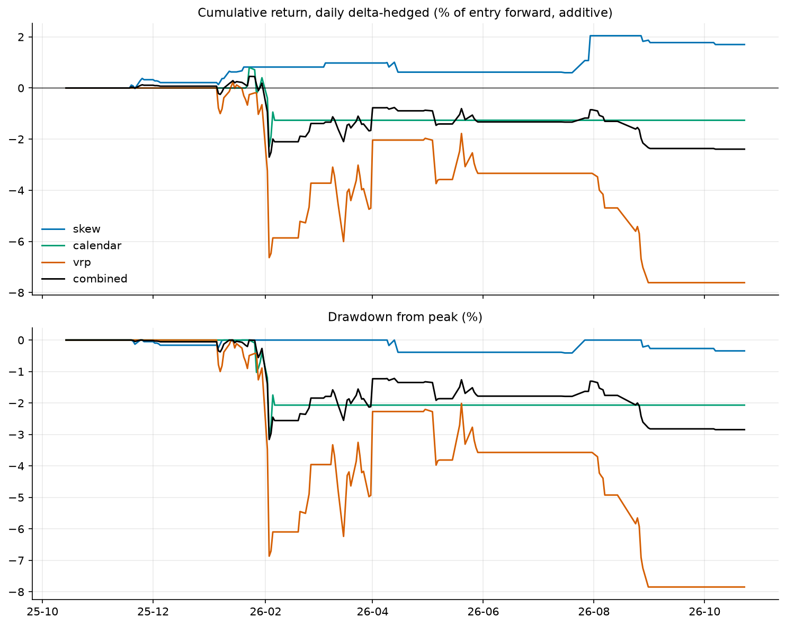
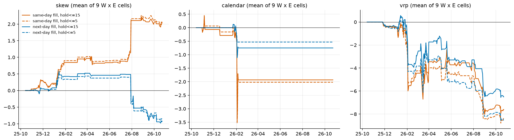
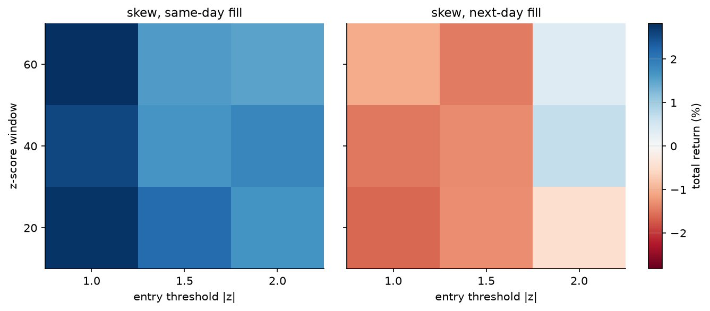
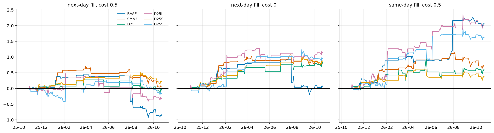
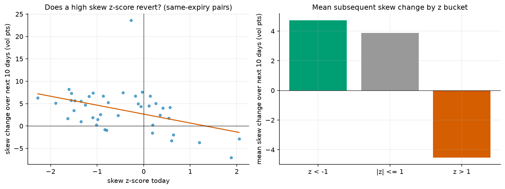

# KOSPI200 변동성 곡면 차익거래 리서치

KOSPI200 월물 옵션의 내재변동성(IV) 곡면에서 **스큐 · 캘린더(기간구조) · IV–RV(VRP)** 세 가지 차익거래 전략을 설계하고,
일별 데이터로 백테스트·민감도·통계검증까지 재현 가능하게 정리한 리서치(학기 프로젝트) 저장소입니다.

> **한 줄 결론** — 이 표본(2025-10 ~ 2026-10, 상승 후 조정의 단일 사이클, 204일)에서 비용을 반영한 **거래 가능한 알파는 확인되지 않았습니다.**
> 스큐의 "수익"은 신호가 나온 *당일 종가*에 체결할 수 있다고 가정할 때만 나타나고, 하루만 늦춰도 사라졌습니다.
> 신호 노이즈를 줄이면(25-delta 정의 + 3일 평활) 체결 지연 민감도는 크게 줄지만 비용 후 엣지는 통계적으로 유의하지 않았습니다.

## 빠른 시작

```bash
pip install -r requirements.txt
# data/ 폴더에 KRX 원자료 CSV 3개를 넣는다 (data/README.md 참고)
python run_all.py                  # 전체 실행 (약 1분 내외; 최초 1회는 스마일 구축으로 몇 분)
#  저장소·데이터 폴더는 자동 탐색합니다 (스크립트 위치 → 작업 폴더 → 바탕화면/다운로드/문서, OneDrive·한글 폴더명 포함).
#  못 찾으면 --data-dir 로 직접 지정: python run_all.py --data-dir C:\Users\내이름\Desktop\data
python run_all.py --parts baseline,signals   # 일부만
python run_all.py --quick          # 순열검정 횟수를 줄여 빠르게
pytest -q                          # 단위 테스트 (원자료 불필요)
```

실행하면 `results/` 아래에 다음이 생성됩니다.

| 위치 | 내용 |
|---|---|
| 콘솔 + `results/summary.txt` | **모든 성과 수치** (7번 섹션에 전략·조합별 MDD 총괄표 포함): 수익률, 변동성, Sharpe, **MDD**, MDD 지속일수, Calmar, 거래 수, 승률, 평균·최악 거래, Profit Factor, 비용 손익분기, Newey-West t 등 |
| `results/figures/*.png` | 그래프 9종 (**그림 안에는 성과 수치를 넣지 않음** — 수치는 표/콘솔에서만 확인). 파일로 저장되고, 스파이더·주피터에서 실행하면 화면에도 표시됩니다 (`--show` / `--no-show`로 강제) |
| `results/tables/*.csv` | 각 실험의 원자료 표 (셀 단위 결과, 거래 로그 포함) |

## 저장소 구조

```
run_all.py              전체 실험 실행 → 그림/표/요약 생성 (CLI)
src/volarb/
  config.py             상수, Params(백테스트 파라미터)
  data.py               KRX CSV 로딩, 월물별 IV 스마일 구축 (필터·거래량 가중·OTM만·보간)
  pricing.py            Black-76 가격/델타/베가
  indicators.py         스큐·기간구조·VRP, 25-delta 스큐, 3일 평활, rolling/robust z-score
  strategies.py         포지션 빌더 (리스크리버설, 베가중립 캘린더, ATM 스트래들 + 잔존일 사이징)
  engine.py             백테스트 엔진 (체결 지연, 일별 델타 재헤지, 손절, 비용)
  backtest.py           Spec/Backtester, 격자·앙상블 실행과 캐시
  metrics.py            MDD, Sharpe, Calmar, Profit Factor, Newey-West t ...
  experiments.py        실험 세트 정의 (baseline / execution / cost / combos / signals)
  stats_tests.py        스큐 평균회귀 통계검증 (HAC, 순열, 비중첩, 견고성)
  plots.py, report.py   그림, 콘솔·파일 리포트
tests/test_core.py      핵심 로직 단위 테스트 (합성 데이터)
data/                   원자료 위치 (git 제외)
results/                실행 결과 (그림·표·요약)
```

## 데이터 준비

KRX 일별 원자료(`kospi200_options_regular.csv`, `kospi200_futures_regular.csv`, `kospi200_spot.csv`)를 `data/`에 넣습니다.
용량과 이용조건 때문에 저장소에는 포함하지 않았습니다. 필요한 컬럼은 [`data/README.md`](data/README.md)에 있습니다.
**데이터는 일별(종가·시고저·누적거래량) 자료이며 장중(인트라데이) 호가는 없습니다** — 아래 한계 참고.

## 방법 요약

**IV 곡면.** 날짜·만기별로 거래량 ≥10, 미결제약정 ≥10, IV 3~150%, 잔존 5~180일, K/F 0.85~1.15 필터를 통과한 **OTM 옵션**의 IV를
거래량 가중해 스마일을 만들고, 행사가 방향으로 선형 보간합니다(외삽 없음, 인접 행사가 간격 0.06 초과 시 결측).
선물가 F는 같은 만기 선물 종가입니다.

**지표와 신호.**

| 전략 | 지표 | 방향 (z>0일 때) |
|---|---|---|
| 스큐 | `IV(K/F=0.90) − IV(1.10)` (근월물) | 리스크리버설 매도 (풋 매도 + 콜 매수) |
| 캘린더 | 원월 ATM IV − 근월 ATM IV | 근월 스트래들 매수 / 원월 매도 (베가 중립) |
| VRP | 근월 ATM IV − 20일 실현변동성 | ATM 스트래들 매도 (잔존일 사이징) |

신호는 지표의 rolling z-score (윈도우 W∈{20,40,60}, 진입 |z|≥E∈{1.0,1.5,2.0}, 청산 |z|<0.3, 최대 보유 15일).

**회계 (v2).** 손익 = (옵션 평가액 − 진입가) + 누적 헤지손익. 비용은 매수 +IV / 매도 −IV로 **진입·청산 각각 레그당 0.5 IV-pt**.
일별 재헤지는 전일 델타로 잡은 선물이 당일 변동만큼 손익을 냅니다. 포지션은 한 번에 하나, 수익률은 진입 선물가 기준 가산 누적.

## 실험과 결과

모든 수치는 `results/summary.txt`에서 그대로 가져왔습니다. **앙상블** = 윈도우 3 × 진입 임계 3 = 9개 셀의 일별 손익 평균입니다
(사후에 좋은 셀을 고르는 편향을 피하기 위함). `cell ret%`는 9개 셀 수익률의 평균.

### 1. 기본 백테스트 (W=40, |z|≥1.5, 최대보유 15일, 당일 종가 체결, 일별 재헤지)

| 전략 | 수익률 % | Sharpe | MDD %p | 유효거래 |
|---|---|---|---|---|
| 스큐 | +1.70 | 1.43 | −0.41 | 11 |
| 캘린더 | −1.26 | −0.53 | −3.10 | 1 |
| VRP | −7.61 | −1.20 | −7.85 | 8 |
| 합산(각 1/3) | −2.39 | −0.91 | −3.16 | 20 |

캘린더는 원월 ATM 호가가 있는 날이 79일뿐이라 거래가 1건 — **검증 불가**입니다.
VRP가 음수인 것은 이 표본에서 실현변동성이 내재변동성을 자주 웃돌았기 때문으로 보이며(상승 후 조정 한 사이클), 일반화할 수 없습니다.



### 2. 체결 가정 민감도 — 스큐 이득은 "당일 종가 체결" 가정에 의존

| 전략 (보유 ≤5일) | 당일 체결 cell ret% (+셀) | 익일 체결 cell ret% (+셀) | 익일 NW t |
|---|---|---|---|
| 스큐 | +2.07 (9/9) | −0.85 (2/9) | −0.91 |
| 캘린더 | −2.02 (0/9) | −0.53 (0/9) | −1.10 |
| VRP | −8.36 (0/9) | −8.53 (0/9) | −1.74 |




### 3. 거래비용 민감도 (스큐, 익일 체결)

기존 신호(BASE)는 비용 0에서 +0.07%, 0.5 IV-pt에서 −0.85%. 손익분기 비용은 약 0.04 IV-pt로 사실상 0입니다.
거래 가능성은 비용 가정에 크게 좌우되므로 **실제 호가 스프레드 데이터로 검증**이 필요합니다.

### 4. 스큐 변형 3종 조합 (S=손절, D=잔존 10일 미만 금지, M=중앙값/MAD z)

익일 체결 기준 어떤 조합도 양(+)의 비용 후 엣지를 만들지 못했습니다(BASE −0.85 → S −0.85, D −1.25, M −0.82, SDM −1.13).
손절(S)은 포지션이 평균 약 3일 만에 청산되어 z가 더 벌어질 시간이 없어 **거래 결과가 전혀 달라지지 않았습니다**.

### 5. 신호 노이즈 저감: 25-delta 정의 × 3일 평활 (익일 체결, 비용 0.5 / 0)

**변형 이름 (표와 `08_signal_variants.png` 범례 공통).** `D25` = 25-delta 정의, `S`/`SMA3` = 3일 평활, `L` = 거래 행사가도 25-delta로.

| 이름 | 신호(진입 판단 지표) | 거래하는 행사가 |
|---|---|---|
| BASE | `IV(K/F=0.90) − IV(1.10)` | 풋 0.90 / 콜 1.10 |
| SMA3 | BASE 지표의 3일 평균 | 풋 0.90 / 콜 1.10 |
| D25 | `IV(25Δ 풋) − IV(25Δ 콜)` | 풋 0.90 / 콜 1.10 |
| D25L | D25와 같음 | 25Δ 풋 / 25Δ 콜 |
| D25S | D25 지표의 3일 평균 | 풋 0.90 / 콜 1.10 |
| D25SL | D25S와 같음 | 25Δ 풋 / 25Δ 콜 |

그림의 세 패널은 체결 가정만 다릅니다: 왼쪽 다음날 체결·비용 0.5, 가운데 다음날 체결·비용 0, 오른쪽 당일 체결·비용 0.5. 선은 9개 셀(윈도우 3 × 진입 임계 3) 평균의 누적 수익률(%)입니다.

| 변형 | cell ret% (비용0.5) | +셀 | NW t (0.5) | cell ret% (비용0) | NW t (0) | 당일→익일 수익률 변화 %p |
|---|---|---|---|---|---|---|
| BASE | −0.85 | 2/9 | −0.91 | +0.07 | +0.08 | −2.92 |
| SMA3 | +0.07 | 4/9 | +0.13 | +0.83 | +1.41 | −0.65 |
| D25 | −0.05 | 4/9 | −0.11 | +0.81 | +1.95 | −0.65 |
| D25S | +0.21 | 8/9 | +0.62 | +0.87 | +2.36 | −0.16 |

25-delta 신호(D25)와 3일 평활(SMA3, D25S) 모두 **체결 지연 민감도를 크게 낮췄지만**(마지막 열), 비용 0.5 IV-pt를 내면 유의하지 않습니다.
25-delta 행사가로 직접 거래한 변형(D25L, D25SL)은 0.90/1.10 레그보다 나빴습니다.
전체 표는 `results/summary.txt`, 곡선은 아래 그림.



### 6. 스큐 평균회귀 통계검증

`Δskew(t→t+h) = a + b·z_t + e`, 사전 지정 사양 W=40, h=10, 동일 만기 쌍 (n=42): **b = −2.00, NW t = −2.78 (p=0.004), 순열 p=0.020.**
같은 만기 쌍으로 한정하고 NW 표준오차·순열검정을 써도 평균회귀 자체는 통계적으로 존재합니다. 그러나

* 진입을 1일 미루면 계수가 약 1/2~1/3로 줄고, 2일 미루면 대부분 사라집니다 (`skew_robustness.csv`).
* 일별 스큐 변화의 1차 자기상관이 **−0.28**: 오른 다음날 되돌아오는 성분이 큽니다 (종가 IV의 일시적 오차로 추정).
* 스큐는 잔존일이 줄수록 높아지는 경향(상관 −0.447)이 있어 만기 구조에 오염됩니다.



## 한계와 주의

* **표본:** 204일, 상승 후 조정의 단일 사이클(2025-10 ~ 2026-10). 유효 거래 수가 셀당 0~20건이라 개별 셀 수치는 근거가 되지 못합니다.
* **다중비교:** 전략 × 체결 가정 × 신호 변형 × 격자를 많이 비교했으므로, 그중 좋아 보이는 결과(예: D25S)는 사후 선택에 따른 낙관 편향이 있습니다.
* **일별 데이터:** 호가·장중 데이터가 없어 체결가를 종가로 가정하고 거래비용(0.5 IV-pt)도 가정치입니다.
* **단순화:** 무위험금리 연 2.5% 고정, 증거금·포지션 한도 미모델링, z-score 윈도우는 결측일을 건너뜀.
* 이 저장소는 학습·리서치 목적이며 투자 권유가 아닙니다.

## 이력 (정정 기록)

초기 버전(`v1`)의 백테스트 엔진에는 **진입 프리미엄을 빼지 않고 비용 부호가 틀린 회계 오류**가 있어, 그 결과("매도가 구조적으로 불리", "잔존일 테이퍼가 MDD 개선")는 **폐기**했습니다.
이 저장소는 정정된 엔진(v2)만 담고 있고, `tests/`가 핵심 회계 성질(시간가치 손실, 비용 방향, 선견편향 없음)을 검증합니다.

## 다음 단계 후보

* 실제 호가 스프레드·장중 데이터로 비용 가정과 체결 시점 검증 (KRX 시장데이터, 또는 Eurex의 KRX 연계 상품 야간 데이터 등)
* 캘린더용 완화된 기간구조 지표(원월 ATM 조건 완화)로 거래 수 확보
* 다른 장세·더 긴 표본으로 확장
